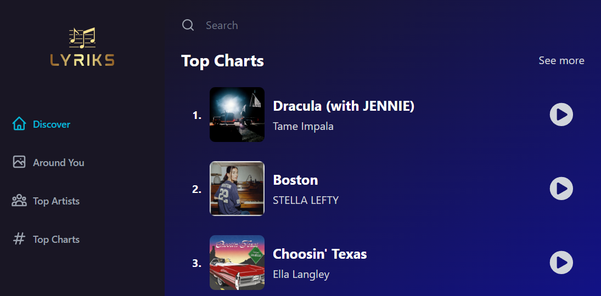

# Lyriks

Lyriks is a responsive music discovery and preview app built with React. Browse trending tracks, explore music by genre, search for songs, view artist and track details, and play the preview available for a track.

Music data and preview audio are provided by the public Deezer API. The app requests the API's JSONP responses directly from the browser, so **no API key or `.env` file is required**.

## Screenshot



## Features

- Discover tracks by genre.
- Browse the current worldwide chart and top-chart tracks.
- Search for songs and open artist or track detail pages.
- Play available track previews, with playback controls for play/pause, next/previous, repeat, shuffle, seeking, and volume.
- Responsive navigation and layout for desktop and mobile screens.

Previews are short samples, not full-track streaming. Preview availability depends on Deezer's catalog and may vary by track or region. Lyrics are not provided by the current music API integration.

## Getting started

### Requirements

- Node.js and npm
- An internet connection to load the app's music data, artwork, and preview audio

### Install and run

```bash
npm install
npm run dev
```

Open the local URL printed by Vite in your browser.

### Production build

```bash
npm run build
npm run preview
```

`npm run build` writes the optimized site to `dist/`. `npm run preview` serves that build locally for a production-style check.

## Using the app

- **Discover** — browse tracks and choose a genre from the selector.
- **Around You** — browse the worldwide trending chart. Despite the navigation label, this page is worldwide rather than location-specific; the current public API integration does not fetch a user's location.
- **Top Charts** — browse chart tracks.
- **Top Artists** — open artist pages from the chart's artists.
- **Search** — enter a query in the search field and submit it to see matching tracks.
- **Track and artist pages** — select a track or artist name to view available details and related/top tracks.

Some genre choices are approximated because the provider's genre catalog does not include a matching category for every app option. Country and K-Pop selections use music search; House uses the Dance category; Worldwide uses the chart feed. Results can therefore differ from a dedicated genre chart.

## Technology

- React 18
- Vite
- React Router
- Redux Toolkit and RTK Query
- Tailwind CSS
- React Icons
- Swiper
- Deezer public API for chart, search, track, artist, and preview data

## Project structure

```text
src/
  App.jsx                    App shell and route definitions
  index.jsx                  React entry point and Redux/router providers
  assets/
    constants.js             Discover genre options
  components/
    MusicPlayer/             Preview player and playback controls
    ...                       Navigation, song cards, details, and loading UI
  pages/                     Discover, chart, search, and detail pages
  redux/
    features/playerSlice.js  Current track and player state
    services/shazamCore.js   RTK Query API calls and Deezer data normalization
    store.js                 Redux store configuration
```

The service module retains the `shazamCore` filename for compatibility with the app's existing imports; its current provider is Deezer.

## Configuration

There are no required environment variables. Do not add API credentials to the frontend for the current integration.

The music service is loaded directly in the browser using JSONP. A browser extension, network policy, or Content Security Policy that blocks third-party scripts or Deezer domains can prevent data from loading. Deezer's availability, catalog, preview URLs, and response behavior are outside the app's control.

## Available npm scripts

| Command           | Description                           |
| ----------------- | ------------------------------------- |
| `npm run dev`     | Start the Vite development server.    |
| `npm run build`   | Create a production build in `dist/`. |
| `npm run preview` | Preview the production build locally. |

The project currently does not define a test script.
